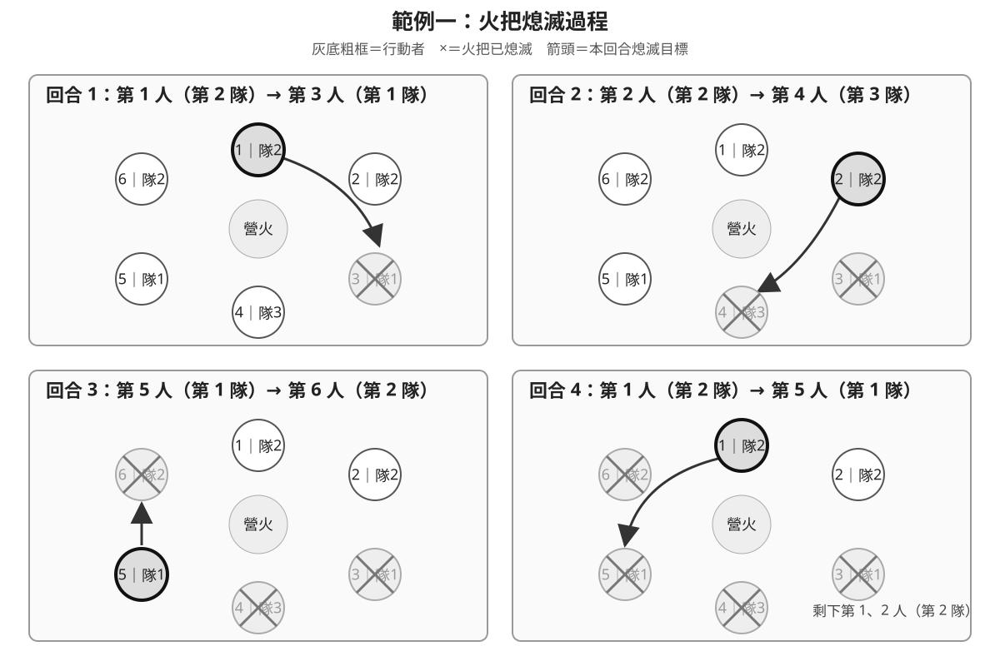

範例程式請傳到: edychie0323@gmail.com
範例測資以製作完畢，還請各位大佬先行製作範例程式

# P1 營火競賽

## 題目敘述

為了決定哪一支隊伍要負責隔日的營地建設，營隊舉辦了一場火把競賽。

有 $n$ 個人圍著位於中央的營火站成一個圓圈，所有人都面向營火，並依順時針方向編號為 $1$ 到 $n$。也就是說，第 $i$ 個人的左手邊是順時針方向的下一個位置；第 $n$ 個人的左手邊繼續繞行後會回到第 $1$ 個人。

每個人都屬於一支隊伍，且一開始每個人的火把都是點燃的。任意兩位相鄰的人可能屬於同一支隊伍，也可能屬於不同隊伍；題目不保證一個人左右兩旁的人與他之間的隊伍關係。

競賽開始時，由第 $1$ 個人率先拿起滅火器。拿著滅火器且火把仍然點燃的人稱為「行動者」。每一回合依照以下步驟進行：

1. 行動者從自己的左手邊開始，沿順時針方向逐一查看其他人。
2. 如果遇到火把已經熄滅的人，直接跳過此人，繼續向前尋找。
3. 如果遇到火把仍然點燃、但與行動者同隊的人，也跳過此人，繼續向前尋找。
4. 找到第一位火把仍然點燃且與行動者不同隊伍的人後，行動者立即熄滅此人的火把。此人之後不會再成為行動者。
5. 若競賽尚未結束，滅火器由「本回合的行動者」開始向左手邊傳遞，交給順時針方向第一位火把仍然點燃的人，由他成為下一回合的行動者。

搜尋目標或傳遞滅火器時，都可能繞過編號 $n$ 回到編號 $1$，並持續沿圓圈尋找。特別注意，下一位行動者是從本回合行動者的左手邊開始尋找，而不是從剛被熄滅火把的人開始尋找。

每回合結束後，檢查所有火把仍然點燃的人所屬的隊伍：

- 如果仍有兩支以上的隊伍，競賽繼續。
- 如果所有火把仍然點燃的人都屬於同一支隊伍，競賽立即結束，該隊伍負責隔日的營地建設。

若一開始就只有一支隊伍，也就是 $k=1$，則不會進行任何回合，熄滅的火把數量為 $0$，該隊伍直接負責隔日的營地建設。

請求出整場競賽中一共被熄滅了幾支火把，以及最後負責隔日營地建設的隊伍編號。

## 輸入說明

第一行包含兩個整數 $n$、$k$（$1 \le k \le n \le 2000$），分別代表人數與隊伍數量。隊伍編號為 $1$ 到 $k$。

第二行包含 $n$ 個整數 $t_1,t_2,\ldots,t_n$（$1 \le t_i \le k$），其中 $t_i$ 表示第 $i$ 個人所屬的隊伍編號。輸入保證編號 $1$ 到 $k$ 的每支隊伍都至少有一位成員。

## 子題配分

本題共分為以下兩個子題：

| 子題 | 配分 | 額外限制 |
| ---: | ---: | --- |
| 1 | 40% | $n < 1000$ |
| 2 | 60% | 無額外限制，符合原題限制 $1 \le k \le n \le 2000$ |

## 輸出說明

輸出兩個整數 $x$、$w$，以一個空白分隔：

- $x$ 表示競賽過程中被熄滅的火把總數。
- $w$ 表示最後負責隔日營地建設的隊伍編號。

## 範例一

### 輸入

```text
6 3
2 2 1 3 1 2
```

### 輸出

```text
4 2
```

### 範例一說明



| 回合 | 行動者 | 被熄滅火把的人 |
| ---: | --- | --- |
| 1 | 第 1 個人（第 2 隊） | 第 3 個人（第 1 隊） |
| 2 | 第 2 個人（第 2 隊） | 第 4 個人（第 3 隊） |
| 3 | 第 5 個人（第 1 隊） | 第 6 個人（第 2 隊） |
| 4 | 第 1 個人（第 2 隊） | 第 5 個人（第 1 隊） |

詳細過程如下：

1. 第 1 個人屬於第 2 隊。他向左依序遇到第 2 個人（同隊，跳過）及第 3 個人（不同隊），因此熄滅第 3 個人的火把。接著由第 2 個人成為行動者。
2. 第 2 個人屬於第 2 隊。他向左依序跳過火把已熄滅的第 3 個人，接著找到第 4 個人（第 3 隊），因此熄滅第 4 個人的火把。接著由第 5 個人成為行動者。
3. 第 5 個人屬於第 1 隊。他向左找到第 6 個人（第 2 隊），因此熄滅第 6 個人的火把。接著沿圓圈繞回第 1 個人，由第 1 個人成為行動者。
4. 第 1 個人屬於第 2 隊。他向左跳過同隊的第 2 個人，以及火把已熄滅的第 3、4 個人，接著找到第 5 個人（第 1 隊），因此熄滅第 5 個人的火把。

此時只有第 1、2 個人的火把仍然點燃，且兩人都屬於第 2 隊，因此競賽結束。總共熄滅 4 支火把，最後由第 2 隊負責隔日的營地建設。

## 範例二

### 輸入

```text
7 3
1 2 1 3 2 3 2
```

### 輸出

```text
6 2
```

### 範例二說明

| 回合 | 行動者 | 被熄滅火把的人 |
| ---: | --- | --- |
| 1 | 第 1 個人（第 1 隊） | 第 2 個人（第 2 隊） |
| 2 | 第 3 個人（第 1 隊） | 第 4 個人（第 3 隊） |
| 3 | 第 5 個人（第 2 隊） | 第 6 個人（第 3 隊） |
| 4 | 第 7 個人（第 2 隊） | 第 1 個人（第 1 隊） |
| 5 | 第 3 個人（第 1 隊） | 第 5 個人（第 2 隊） |
| 6 | 第 7 個人（第 2 隊） | 第 3 個人（第 1 隊） |

第 4 回合中，第 7 個人沿順時針方向繞回圓圈前端，找到第 1 個人。

第 6 回合結束後，只剩第 7 個人的火把仍然點燃，他屬於第 2 隊，因此競賽結束。總共熄滅 6 支火把，最後由第 2 隊負責隔日的營地建設。


---

# P2 火星探測資料

## 題目敘述

火箭研發團隊成功將探測器送達火星。探測器在火星表面執行任務後，共取得了 $k$ 筆探測結果。為了方便儲存與傳輸，每筆探測結果都被轉換成一個長度為 $n$、僅由小寫英文字母 `a` 到 `z` 組成的字串。

然而，從火星將資料傳回地球需要消耗大量能源。若逐筆傳送所有探測結果，相同的資料片段可能會被重複傳送，造成不必要的能源消耗。因此，研發人員希望把所有探測結果合併成一個字串 $S$，再將 $S$ 傳回地球。

合併後，原本的每一筆探測結果都必須完整且連續地出現在 $S$ 中。換句話說，每個輸入字串都必須是 $S$ 的**連續子字串**。不同探測結果在 $S$ 中所占的位置可以互相重疊，也可以完全不重疊，而且不必按照輸入順序出現。

例如，字串 `abcd` 與 `cdef` 的結尾與開頭都有 `cd`，因此可以重疊合併成 `abcdef`，而不必合併成 `abcdcdef`。利用這種方式，可以減少 $S$ 的長度及傳輸所需的能源。

請找出符合上述條件且長度最短的字串 $S$。若有多個字串的長度同為最短，則輸出其中字典序最小的字串。

## 判定規則

1. 第一優先是讓 $S$ 的長度最短。
2. 只有在多個可行字串的長度相同且皆為最短時，才比較它們的字典序。
3. 每筆探測結果只需要在 $S$ 中出現至少一次。
4. 若輸入中有內容相同的探測結果，同一段子字串可以同時滿足這些相同的探測結果，不需要重複出現多次。

### 連續子字串說明

若能從 $S$ 中選取一段位置相鄰且順序不變的字元，得到字串 $T$，則稱 $T$ 是 $S$ 的連續子字串。例如，`bcd` 是 `abcde` 的連續子字串，但 `ace` 不是，因為 `a`、`c`、`e` 在原字串中並不相鄰。

### 字典序說明

比較兩個不同的字串時，由左至右找到第一個不同的字元。該位置字元較小的字串，其字典序較小。本題所有字元皆為小寫英文字母，且依照 `a`、`b`、`c`、……、`z` 的順序比較。

例如，`aaaa` 的字典序小於 `aaab`；`abcaa` 與 `abcba` 的前三個字元相同，但第四個字元分別為 `a` 與 `b`，因此 `abcaa` 的字典序較小。

## 輸入說明

第一行包含兩個整數 $n$、$k$（$1 \le n \le 8$，$1 \le k \le 9$），分別代表每筆探測結果的長度與探測結果的筆數。

接下來 $k$ 行，每行包含一個長度恰好為 $n$、僅由小寫英文字母組成的字串，代表一筆探測結果。

## 輸出說明

輸出一行字串 $S$。$S$ 必須包含所有輸入字串作為連續子字串，且長度必須最短。若答案不唯一，輸出其中字典序最小者。

## 範例一

### 輸入

```text
4 2
aaaa
bbbb
```

### 輸出

```text
aaaabbbb
```

### 範例一說明

`aaaa` 的非空後綴無法與 `bbbb` 的前綴相同，反過來也一樣，因此兩個字串無法重疊。任何可行答案的長度至少為 8。

`aaaabbbb` 與 `bbbbaaaa` 都包含這兩筆探測結果，且長度都是 8。比較字典序時，第一個字元分別為 `a` 與 `b`，因此 `aaaabbbb` 較小，應輸出 `aaaabbbb`。

## 範例二

### 輸入

```text
4 6
aaaa
aaab
aaba
aabc
abaa
baaa
```

### 輸出

```text
aabaaaabc
```

### 範例二說明

在輸出字串 `aabaaaabc` 中，各筆探測結果的位置如下（位置由 1 開始計算）：

| 探測結果 | 在輸出字串中的位置 |
| --- | --- |
| `aaba` | 第 1 至第 4 個字元 |
| `abaa` | 第 2 至第 5 個字元 |
| `baaa` | 第 3 至第 6 個字元 |
| `aaaa` | 第 4 至第 7 個字元 |
| `aaab` | 第 5 至第 8 個字元 |
| `aabc` | 第 6 至第 9 個字元 |

因此，`aabaaaabc` 的確包含全部六筆探測結果。

由於六個輸入字串彼此不同，而長度為 $L$ 的字串只有 $L-4+1$ 個長度為 4 的連續子字串位置，因此要容納六個不同的輸入字串，$S$ 的長度至少為 9。

將六筆資料依照 `aaba`、`abaa`、`baaa`、`aaaa`、`aaab`、`aabc` 的順序排列時，每一筆的後三個字元都與下一筆的前三個字元相同，所以它們可以依序重疊，得到長度為 9 的 `aabaaaabc`。

這個結果達到前述長度下限，因此不可能再縮短。經比較所有長度為 9 的可行字串後，`aabaaaabc` 的字典序最小，所以答案為 `aabaaaabc`。


---

# P3 考拉茲距離

## 題目敘述

對一個正整數 $n$ 進行一次**考拉茲操作**，規則如下：

1. 若 $n$ 為奇數，將 $n$ 變成 $\frac{3n+1}{2}$。
2. 若 $n$ 為偶數，將 $n$ 變成 $\frac{n}{2}$。

因為奇數 $n$ 的 $3n+1$ 一定是偶數，所以上述操作的結果必定仍為正整數。例如，對 $13$ 進行一次操作會得到 $(3\times13+1)/2=20$；接著因為 $20$ 是偶數，再操作一次會得到 $10$。

現在給定一個目標數字 $t$、考拉茲操作次數上限 $m$，以及 $q$ 個彼此獨立的詢問。對於每個詢問的正整數 $a_i$，你可以先選擇另一個正整數 $x$；將 $a_i$ 改成 $x$ 的調整成本定義為 $|a_i-x|$。

接著從 $x$ 開始進行考拉茲操作。請求出最小的調整成本，使 $x$ 能在**不超過 $m$ 次**考拉茲操作後等於 $t$。

這裡的「不超過 $m$ 次」是指可以進行 $0,1,2,\ldots,m$ 次考拉茲操作，不要求恰好操作 $m$ 次。若 $x=t$，即使一次考拉茲操作都不做也符合條件。各詢問互不影響，處理一個詢問時所做的調整不會改變其他詢問。

換句話說，對每個 $a_i$，要在所有能於 $m$ 次以內抵達 $t$ 的正整數 $x$ 中，找出 $|a_i-x|$ 的最小值。至少可以選擇 $x=t$，所以每個詢問一定都有答案。

## 輸入說明

第一行包含三個整數 $t$、$m$、$q$（$1 \le t \le 10^9$，$0 \le m < 32$，$1 \le q < 10^4$，亦即 $q$ 最大為 $9999$），分別代表目標數字、考拉茲操作次數上限，以及詢問數量。

第二行包含 $q$ 個正整數 $a_1,a_2,\ldots,a_q$（$1 \le a_i \le 10^{18}$），依序代表各個詢問的初始數字。

## 輸出說明

輸出 $q$ 行。第 $i$ 行輸出一個非負整數，代表第 $i$ 個詢問的最小調整成本，也就是在所有能於不超過 $m$ 次考拉茲操作後變成 $t$ 的正整數 $x$ 中，$|a_i-x|$ 的最小值。

若 $a_i$ 本身已能在 $m$ 次以內變成 $t$，第 $i$ 行應輸出 $0$。

## 範例一

### 輸入

```text
11 3 3
16 88 200
```

### 輸出

```text
2
0
112
```

### 範例一說明

所有能在不超過 $3$ 次考拉茲操作後變成 $11$ 的正整數為：

| 考拉茲操作次數 | 可行的起始數字 | 操作過程 |
| ---: | --- | --- |
| $0$ | $11$ | $11$ |
| $1$ | $7,22$ | $7\rightarrow11$；$22\rightarrow11$ |
| $2$ | $14,44$ | $14\rightarrow7\rightarrow11$；$44\rightarrow22\rightarrow11$ |
| $3$ | $9,28,29,88$ | $9\rightarrow14\rightarrow7\rightarrow11$；$28\rightarrow14\rightarrow7\rightarrow11$；$29\rightarrow44\rightarrow22\rightarrow11$；$88\rightarrow44\rightarrow22\rightarrow11$ |

- 對 $16$ 而言，最接近的可行數字是 $14$，所以將 $16$ 減少 $2$ 即可，答案為 $2$。
- $88$ 本身就是可行數字，不需要調整，答案為 $0$。
- 對 $200$ 而言，最接近的可行數字是 $88$，所以需要減少 $200-88=112$，答案為 $112$。

## 範例二

### 輸入

```text
5 4 5
1 9 20 27 100
```

### 輸出

```text
2
1
0
1
20
```

### 範例二說明

可以從目標數字 $5$ 反向列出所有可行的起始數字。若目前數字為 $y$，則 $2y$ 一定能在一次操作後變成 $y$；此外，只有當 $(2y-1)/3$ 是正奇數時，它才是另一個合法的前一步數字。

所有能在不超過 $4$ 次考拉茲操作後變成 $5$ 的正整數如下：

| 考拉茲操作次數 | 可行的起始數字 |
| ---: | --- |
| $0$ | $5$ |
| $1$ | $3,10$ |
| $2$ | $6,20$ |
| $3$ | $12,13,40$ |
| $4$ | $24,26,80$ |

各詢問的計算如下：

| 詢問 | 最接近的可行數字 | 加減次數 | 考拉茲操作過程 |
| ---: | ---: | ---: | --- |
| $1$ | $3$ | $2$ | $3 \rightarrow 5$ |
| $9$ | $10$ | $1$ | $10 \rightarrow 5$ |
| $20$ | $20$ | $0$ | $20 \rightarrow 10 \rightarrow 5$ |
| $27$ | $26$ | $1$ | $26 \rightarrow 13 \rightarrow 20 \rightarrow 10 \rightarrow 5$ |
| $100$ | $80$ | $20$ | $80 \rightarrow 40 \rightarrow 20 \rightarrow 10 \rightarrow 5$ |

所以五個詢問依序輸出 $2,1,0,1,20$。


